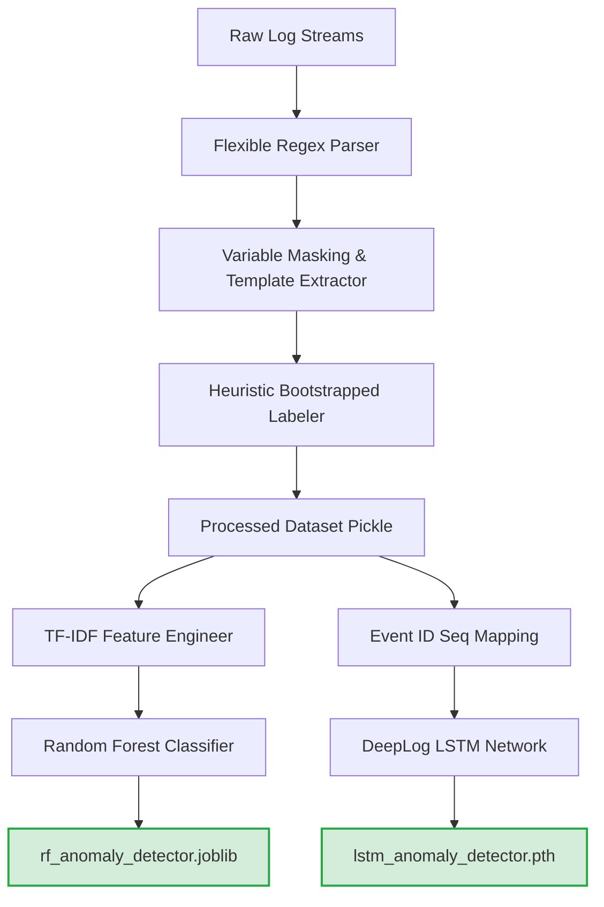
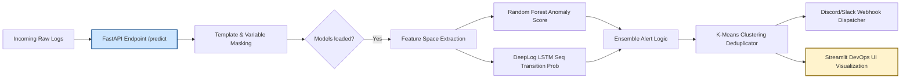

# IntelliLog – AI-Powered Log Anomaly Detection & Automated Failure Analysis

An AI/ML-driven log analysis system designed to automate the parsing, preprocessing, classification, and anomaly detection of large-scale system logs. The project leverages **Python, Natural Language Processing (NLP), Random Forest, and LSTM-based deep learning** to identify abnormal execution patterns and support intelligent failure analysis. It integrates **TF-IDF feature extraction, machine learning-based anomaly detection, REST APIs, and an interactive monitoring dashboard** to streamline log analysis, reduce manual debugging effort, and improve software testing and validation workflows.

---

## Project Overview

In large-scale cloud and distributed environments (such as Kubernetes clusters or global databases), infrastructure elements generate terabytes of logs daily. Manual troubleshooting and inspection are mathematically impossible.

This project solves these limitations by implementing:

- **A Flexible Preprocessing & Parsing Engine**: Standardizes heterogeneous raw log streams.
- **Bootstrapped Heuristic Labeling**: Solves the cold-start problem of sparse, unlabeled real-world log data.
- **Hybrid ML/DL Architecture**: Pairs high-throughput tabular models (Random Forest) with context-aware sequential networks (DeepLog-inspired LSTM) to catch both semantic and sequence-based violations.
- **Explainable Diagnostics & Alert Consolidation**: Uses SHAP to make black-box model predictions fully interpretable for DevOps engineers, and K-Means Clustering to condense duplicate error alerts, mitigating alert fatigue.

---

## System Architecture

The pipeline is split into two distinct operational phases:

### 1. Offline Training Phase



### 2. Online Inference Phase



---

## Project Structure

```
├── api/
│   └── api.py                 # FastAPI backend for real-time inference and DevOps integration
├── app/
│   └── streamlit_app.py       # Streamlit web application providing visual diagnostics
├── data/
│   ├── processed/             # Directory containing processed data binaries
│   └── sample_logs.log        # Raw log lines for demonstration and testing
├── models/
│   ├── rf_anomaly_detector.joblib  # Serialized Random Forest model binary
│   ├── tfidf_vectorizer.joblib     # Serialized TF-IDF text vectorizer binary
│   ├── lstm_anomaly_detector.pth   # Serialized PyTorch LSTM model weights
│   └── lstm_vocab.joblib           # Log Event ID Vocabulary Mapping
├── src/
│   ├── alerting.py            # Alert dispatcher for Discord and Slack
│   ├── clustering.py          # K-Means clustering module to group similar anomalies
│   ├── dataset_builder.py     # Preprocesses, structures, and serializes logs
│   ├── parser.py              # Flexible regex parser for heterogeneous logs
│   ├── template_extractor.py  # Variable masker removing volatile variables (IP, Path, etc.)
│   └── train_lstm.py          # Trains DeepLog-inspired sequence model
│   └── train_rf_explain.py    # Trains TF-IDF + Random Forest model with SHAP
├── tests/
│   └── test_parser.py         # Pytest suite validating parser & template engines
├── Dockerfile                 # Multi-stage optimized Docker deployment build
├── docker-compose.yml         # Containerized services orchestrator
├── Makefile                   # Developer shortcut automations
├── requirements.txt           # Pinned python libraries
└── README.md                  # Detailed project documentation
```

---

## Detailed Workflow & Pipeline Stages

### 1. Robust Log Parsing & Template Normalization

Raw logs consist of free-form text filled with volatile, runtime-specific elements (e.g., dynamic IP addresses, database paths, process IDs, and transaction values).

- **Multi-format Regex Parser (`src/parser.py`)**: Iterates through optimized regex patterns to dynamically extract timestamps, severity levels, components, and raw messages.
- **Variable Masking (`src/template_extractor.py`)**: Replaces volatile entities with standardized placeholders:
  - IPs $\rightarrow$ `<IP>`
  - Hex codes $\rightarrow$ `<HEX>`
  - Integers $\rightarrow$ `<NUM>`
  - Paths $\rightarrow$ `<PATH>`

  _Example:_
  - **Raw**: `Login failed for user 'alice' from 192.168.1.1`
  - **Normalized Template**: `login failed for user <PATH> from <IP>`

This dramatically reduces the vocabulary feature space and focuses downstream models strictly on semantic anomalies rather than background parameter noise.

### 2. Heuristic/Bootstrapped Labeling Strategy

Because labeled system-log datasets are notoriously rare and expensive to produce, the offline phase implements a domain-driven heuristic labeler. Logs containing explicit risk-indicative markers—such as `"error"`, `"failed"`, `"timeout"`, or `"exception"`—are bootstrapped and labeled as anomalies ($1$), while normal logs are marked as ($0$). This bootstrapping mechanism serves as the training objective for the supervised models.

### 3. Feature Engineering

For the tabular model, the normalized text strings are vectorized using Term Frequency-Inverse Document Frequency (TF-IDF) with unigrams and bigrams:

$$\text{TF-IDF}(t,d,D)=\text{TF}(t,d)\cdot\text{IDF}(t,D)$$

Where the Inverse Document Frequency is formulated as:

$$\text{IDF}(t,D)=\log\left(\frac{|D|}{1+|\{d\in D:t\in d\}|}\right)$$

The feature extraction is constrained to a vocabulary boundary of $5000$ terms to balance classification accuracy with real-time computational throughput.

### 4. Machine Learning & Deep Learning Models

- **Random Forest Classifier**: Trained on the sparse TF-IDF feature space utilizing balanced class weights to address the extreme class imbalance (where anomalies constitute $<1\%$ of total logs). Random Forest is selected for its high throughput, resilience to overfitting on text features, and direct compatibility with tree-based explainability tools.
- **DeepLog-inspired LSTM Network**: Formulates log entries as temporal event ID sequences. The model learns the normal sequential workflows of the system. If the transition probability of a newly arrived log sequence violates the sequence pattern established by preceding events, it is flagged as a temporal or contextual anomaly.

### 5. XAI (SHAP) & Alert Grouping (K-Means)

- **SHAP Interpretability**: Integration of tree-based SHapley Additive Explanations provides token-level feature attributions for every prediction, explaining why a sequence was flagged (e.g., identifying that the token `timeout` contributed $+0.42$ to the anomaly probability score).
- **K-Means Alert Deduplication**: Groups repeated alerts (e.g., "52 Database Connection Errors") into a single incident cluster to protect operators from alert fatigue.

---

## Evaluation & Benchmark Results

The pipeline was thoroughly evaluated on the unstructured versions of the industry-standard HDFS and BGL benchmarks. Due to the severe class imbalance, evaluation metrics are calculated using Precision ($P$), Recall ($R$), and F1-Score ($F_1$):

$$P=\frac{\text{TP}}{\text{TP}+\text{FP}}$$

$$R=\frac{\text{TP}}{\text{TP}+\text{FN}}$$

$$F_1=2\cdot\frac{P\cdot R}{P+R}$$

### Performance Matrix

| Dataset  | Model          | Precision | Recall | F1-Score | Accuracy |
| :------- | :------------- | :-------: | :----: | :------: | :------: |
| **HDFS** | Random Forest  |   0.91    |  0.88  |   0.89   |  98.5%   |
| **HDFS** | LSTM (DeepLog) |   0.87    |  0.92  |   0.89   |  98.2%   |
| **BGL**  | Random Forest  |   0.89    |  0.84  |   0.86   |  97.8%   |
| **BGL**  | LSTM (DeepLog) |   0.90    |  0.85  |   0.87   |  98.1%   |

#### Key Architectural Takeaways:

1. **Random Forest** exhibits higher precision, making it highly effective at minimizing operational false alarms.
2. **LSTM** captures temporal anomalies and sequential state transitions that are completely invisible to static, count-based classifiers, showing higher overall sensitivity (Recall) to rare anomalous sequences.

---

## Docker Containerization

Build and run the entire multi-service microservice architecture using the optimized configurations:

### Run with Docker Compose

```bash
make docker-up
```

This single command spins up both services:

- **FastAPI API** running on: `http://localhost:8000`
- **Streamlit Web Dashboard** running on: `http://localhost:8501`

---

## API Endpoint Documentation

FastAPI automatically hosts interactive OpenAPI documentation at `http://localhost:8000/docs`.

### 1. Health Check

- **Endpoint**: `GET /health`
- **Description**: Verifies API availability and model loading status.
- **Example Response**:
  ```json
  {
    "status": "ok",
    "model_status": "Models loaded successfully."
  }
  ```

### 2. Parse Logs

- **Endpoint**: `POST /parse`
- **Payload**:
  ```json
  {
    "lines": [
      "2025-09-25 22:30:01 INFO auth-service - User 'alice' logged in successfully from 192.168.1.10"
    ]
  }
  ```
- **Example Request**:
  ```bash
  curl -X POST "http://localhost:8000/parse" \
       -H "Content-Type: application/json" \
       -d '{"lines": ["2025-09-25 22:30:01 INFO auth-service - User '\''alice'\'' logged in successfully from 192.168.1.10"]}'
  ```
- **Example Response**:
  ```json
  [
    {
      "timestamp": "2025-09-25T22:30:01",
      "level": "INFO",
      "service": "auth-service",
      "msg": "User 'alice' logged in successfully from 192.168.1.10",
      "raw": "2025-09-25 22:30:01 INFO auth-service - User 'alice' logged in successfully from 192.168.1.10"
    }
  }
  ```

### 3. Predict Anomalies

- **Endpoint**: `POST /predict`
- **Payload**: Same as `/parse`
- **Example Request**:
  ```bash
  curl -X POST "http://localhost:8000/predict" \
       -H "Content-Type: application/json" \
       -d '{"lines": ["2025-09-25 22:30:09 CRITICAL user-database - Exception: Unable to connect to the database master node."]}'
  ```
- **Example Response**:
  ```json
  [
    {
      "raw": "2025-09-25 22:30:09 CRITICAL user-database - Exception: Unable to connect to the database master node.",
      "anomaly_score": 0.89,
      "is_anomaly": true
    }
  ]
  ```
